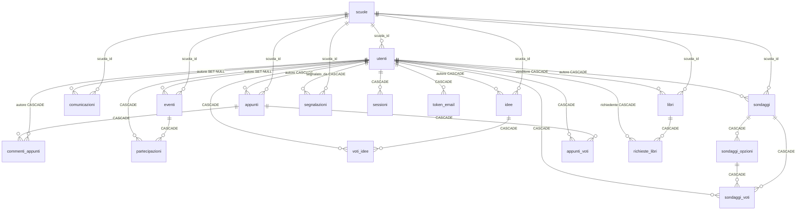

# Database

SQLite, a single file: `data/hub.sqlite` (plus `-wal` and `-shm` side files while the server runs), and `data/uploads/` for note photos. The schema is defined by the numbered migrations in [`src/backend/migrations/`](../src/backend/migrations/) and is **applied automatically at server start-up**: there is nothing to run by hand. The old Supabase/PostgreSQL schema is kept in [`legacy/`](legacy/supabase-schema.sql) and is not used.

Connection settings (`src/backend/db.js`): `journal_mode = WAL`, `foreign_keys = ON` (required for the GDPR cascades), `busy_timeout = 5000`. Setting the environment variable `HUB_DB_FILE` points the app to another database file (used by tests). Timestamps are Unix milliseconds (`INTEGER`); prices are in cents; ids are UUID text.

## 1. Migration system

| Item | Detail |
|---|---|
| Location | `src/backend/migrations/NNN_name.sql`, where `NNN` is three digits (files not matching `^\d{3}_.*\.sql$` are ignored) |
| Applied version | Stored in `meta` (`chiave = 'schema_versione'`). Created by `001_init.sql` with value `1`. Databases created before the runner existed already hold `1`, which matches `001_init.sql` |
| Runner | `migra()` in `db.js`, run once at start-up, before anything else uses the database. Files are sorted by name; each file whose number is greater than the stored version is executed in order |
| Atomicity | Each migration runs in **one transaction** together with the update of `schema_versione`: it either fully applies or not at all |
| Foreign keys | Switched `OFF` while a migration runs (needed for SQLite table rebuilds) and back `ON` afterwards. Because of this, a migration must itself leave the data consistent |
| Current versions | `001_init.sql` (full original schema), `002_multi_school.sql` (table `scuole`, `scuola_id` columns, indexes) |
| Data fix-up for 002 | `retroCompatibilita002()` in `db.js` runs inside the same transaction when the version is `2`: if the database already has users, it creates one school (named from `NOME_SCUOLA` if set, otherwise "Default school") with a fresh invite code and assigns every existing user and content row to it. A fresh install gets **no school** until `school-create` is run. This is the only place where `NOME_SCUOLA` is still read |
| Rollback | None. Always `npm run backup` before an upgrade |

### How to add a migration

1. Create `src/backend/migrations/003_short_description.sql` (next number, no gaps, never reuse or edit a file that was released).
2. Write plain SQL. Prefer `CREATE TABLE`/`ALTER TABLE ... ADD COLUMN`/`CREATE INDEX`. SQLite cannot add a `NOT NULL` column without default, or constraints, via `ALTER`: rebuild the table (create new, copy, drop old, rename), which is why foreign keys are off during migrations.
3. If existing rows need data changes that SQL alone cannot express, add a clearly named function in `db.js` and call it from `migra()` inside the transaction, as is done for version 2 (`if (n === 2) ...`). Keep it idempotent.
4. Keep the application code backward-compatible with the previous schema only if you intend to roll code back (the schema itself cannot be rolled back).
5. Test: delete a copy of the database or use `HUB_DB_FILE=/tmp/test.sqlite`, start the server, check `SELECT valore FROM meta WHERE chiave='schema_versione'`. Also test an upgrade starting from a copy of a real, older database (restored from a backup) and run `npm test`.
6. Update this document (tables, ER diagram) and the changelog.

Note: the header comment of `001_init.sql` still says the file is `schema.sql` and mentions `server/db.js`; this is a leftover and harmless.

## 2. Tables

| Area | Tables | Notes |
|---|---|---|
| Schools (tenancy) | `scuole` | One row per community: name, invite code, optional email domain, optional idea threshold, `attiva` flag, creation time |
| Users and access | `utenti`, `sessioni`, `token_email` | Passwords only as scrypt hash; sessions and email tokens only as SHA-256 |
| Settings | `impostazioni` | Global key/value: `soglia_idee`, `commissione_percentuale`, `max_opzioni_sondaggio` (changed with `npm run admin -- set`). A school's own `soglia_idee` column overrides the global idea threshold (see the routes) |
| Notice board | `eventi`, `partecipazioni`, `comunicazioni` | Only admins write events and announcements |
| Ideas | `idee`, `voti_idee` | Key `(idea, user)`: one endorsement each |
| Polls | `sondaggi`, `sondaggi_opzioni`, `sondaggi_voti` | Key `(poll, user)`: one vote, changeable |
| Notes | `appunti`, `appunti_voti`, `commenti_appunti` | The photo is a file in `data/uploads/`; the table stores its name |
| Books | `libri`, `richieste_libri` | Prices in cents; no payment passes through the app |
| Moderation | `segnalazioni` | One report per user and content item; `contenuto_id` is a plain id without a foreign key |
| Meta | `meta` | `schema_versione` |

### 2.1 Schools and `scuola_id` scoping

`scuole` columns: `id`, `nome` (2 to 100 chars), `codice_invito` (UNIQUE, 10 characters from an alphabet without 0/O/1/I; displayed as `XXXXX-XXXXX`), `dominio_email` (optional, such as `@school.edu`, restricts sign-ups), `soglia_idee` (optional per-school override), `attiva` (`0` = suspended by the operator), `creato_il`.

`scuola_id` (foreign key to `scuole`, **nullable at SQL level**, always set by the application) exists on the **top-level** tables: `utenti`, `comunicazioni`, `eventi`, `idee`, `sondaggi`, `appunti`, `commenti_appunti`, `libri`, `segnalazioni`. Each has an index on it. **Child tables carry no `scuola_id`**: they inherit the school from the parent row (`voti_idee` through `idee`, `sondaggi_opzioni` and `sondaggi_voti` through `sondaggi`, `appunti_voti` through `appunti`, `partecipazioni` through `eventi`, `richieste_libri` through `libri`). `sessioni` and `token_email` belong to a user and therefore indirectly to a school.

Consequences to keep in mind:

- **Isolation between schools is enforced by application queries** (`WHERE scuola_id = ?` in the routes), not by the database. A new query that forgets the filter leaks data across schools. Review every new query for this, and add a test.
- `scuola_id` has no `NOT NULL` or `ON DELETE` rule: deleting a school must be done through `db.eliminaScuola` (below), not with a bare `DELETE FROM scuole`.
- Email addresses are **globally unique** (`utenti.email UNIQUE COLLATE NOCASE`): one email belongs to one school.
- The `ruolo = 'admin'` column is global as well: the CLI command `promote` is not tied to a school.

## 3. Entity-relationship overview

Simplified: only the main relationships; `scuola_id` links from the content tables to `scuole` are shown as one group.



`segnalazioni.contenuto_id` points to an idea, poll, note, comment or book depending on `tipo`, without a foreign key (it is polymorphic), so deleting the content does not remove its reports automatically.

## 4. Deletion cascades (GDPR right to erasure)

### 4.1 Deleting an account: `db.eliminaUtente(id)`

CLI: `npm run admin -- delete-user <email>`; also used by the user's own "delete account" function and by the automatic clean-up (`cleanup.js`: unverified accounts after `RITENZIONE_NON_VERIFICATI_GIORNI`, inactive accounts after `RITENZIONE_INATTIVI_MESI`).

1. The ids of the user's photo files are read first (`appunti.foto` where `autore_id = user`).
2. `DELETE FROM utenti WHERE id = ?`. With `foreign_keys = ON` this cascades to: `sessioni`, `token_email`, the user's `idee`, `sondaggi`, `appunti`, `commenti_appunti`, `libri`, their `segnalazioni`, and all of their votes, participations and book requests, and, through those parents, the children of what was deleted (votes on their ideas, options and votes of their polls, comments and votes on their notes, requests on their books).
3. `eventi.autore_id` and `comunicazioni.autore_id` are set to `NULL` (`ON DELETE SET NULL`): announcements and events **stay**, without author.
4. The photo files are removed from `data/uploads/` (`db.rimuoviFoto`, which accepts only names matching `^[a-f0-9-]+\.(jpg|png|webp)$`).

Not covered by the cascade: reports (`segnalazioni`) filed by *other* users about the deleted content remain until resolved and expired (resolved reports older than 90 days are removed by the clean-up); and **backups** keep the data until they expire (see section 5).

### 4.2 Deleting a school: `db.eliminaScuola(id)`

CLI: `npm run admin -- school-delete <school> --yes` (without `--yes` it only warns and exits). `<school>` may be the name, id or invite code.

1. Photo names of all notes of the school are read first.
2. In **one transaction**: content tables are emptied in this order, filtered by `scuola_id`: `eventi`, `comunicazioni`, `segnalazioni`, `idee`, `sondaggi`, `appunti`, `libri` (their children cascade). Then `DELETE FROM utenti WHERE scuola_id = ?` (cascades to sessions, tokens, remaining votes, comments, participations and requests), and finally the `scuole` row. Content is deleted *before* users so that `SET NULL` author links do not leave orphans behind.
3. After the transaction commits, the photo files are removed from disk.

`commenti_appunti` rows are removed through their parent notes or authors. If you add a new top-level table with `scuola_id`, **add it to the list in `eliminaScuola`** and to this document, or school deletion will fail (foreign key) or leave rows behind.

Related: `school-suspend` is reversible and keeps all data (it sets `attiva = 0` and deletes the sessions of the school's users).

### 4.3 Caveats (not verified in this document)

- SQLite does not necessarily overwrite deleted content immediately: freed pages and the WAL file may still contain it until reused, checkpointed or the database is `VACUUM`ed. The project does not run `VACUUM` automatically. For an erasure that must be forensically complete, consider a `VACUUM` after bulk deletions (take a backup first, it needs free disk space and a quiet moment). Disk-level encryption is the practical mitigation.
- Restores bring back deleted data: see below.

## 5. Backup and restore

```bash
npm run backup        # data/backups/hub-YYYYMMDD-hhmmss/{hub.sqlite, uploads/}
```

- The script uses SQLite's online backup API (`db.backup`), so it is consistent while the server runs, then copies `data/uploads/`. Backups older than `RITENZIONE_BACKUP_GIORNI` (default 30) are deleted by the script.
- Do not copy `data/hub.sqlite` with `cp` while the server runs (WAL mode): use the backup script, or stop the service first.
- **Restore:** stop the service; replace `data/hub.sqlite` and `data/uploads/` with the backup's; **delete** `data/hub.sqlite-wal` and `data/hub.sqlite-shm`; start the service. If the code is newer than the backup, pending migrations are applied at start-up.
- After a restore, **re-run the erasures** (accounts or schools) requested after the backup was taken, and keep a request log ([eu/gdpr/PROCEDURES.md](eu/gdpr/PROCEDURES.md)).
- Off-site copies must be encrypted and expire on the same schedule. Practical steps and a restore test: [HOSTING.md](HOSTING.md#stage-6-backups-and-a-restore-test).

## 6. Management commands

```bash
npm run admin -- school-create "Name" [@domain]   # creates a school, prints the invite code
npm run admin -- school-list                      # schools, codes, members
npm run admin -- school-code <school>             # new invite code
npm run admin -- school-suspend <school>          # block sign-in/sign-up (reversible)
npm run admin -- school-activate <school>
npm run admin -- school-delete <school> --yes     # permanent
npm run admin -- school-of <email>                # which school a user is in
npm run admin -- promote <email>                  # make admin (after registration and email confirmation)
npm run admin -- demote <email>
npm run admin -- verify <email>                   # confirm email by hand
npm run admin -- delete-user <email>              # account + content + photos
npm run admin -- list                             # users
npm run admin -- logout-all                       # emergency: closes all sessions and pending email links
npm run admin -- set soglia_idee 40               # change a rule without touching code
npm run admin -- settings
npm run admin -- cleanup                          # run the retention clean-up now
npm run admin -- stats                            # row counts
npm run backup
```

## 7. Inspecting the database by hand

With the `sqlite3` program or [DB Browser for SQLite](https://sqlitebrowser.org): open `data/hub.sqlite` **read-only**, and when the server is running work on a copy made with `npm run backup`. The database contains personal data, many of them minors': treat every copy accordingly. Useful checks:

```sql
SELECT valore FROM meta WHERE chiave = 'schema_versione';
PRAGMA foreign_key_check;           -- must return no rows
PRAGMA integrity_check;             -- must return "ok"
SELECT COUNT(*) FROM utenti WHERE scuola_id IS NULL;   -- should be 0
```
